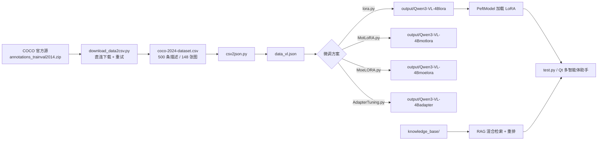
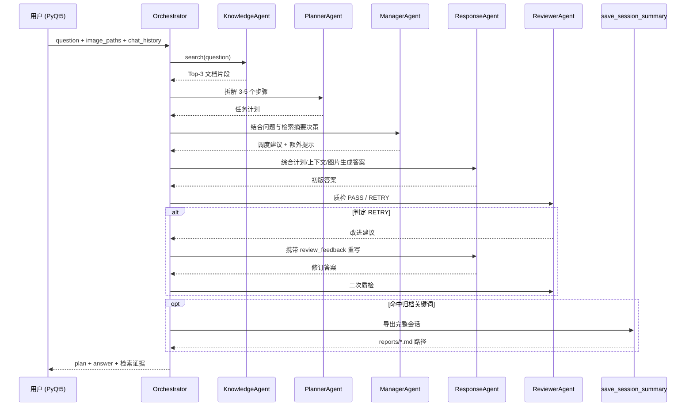

# 🧠 Qwen3-VL-MoeLORA · 多模态微调 + 本地 RAG 多智能体助手
        

## 📋 项目简介

一个「单卡 8GB 显存即可跑通」的多模态大模型工程闭环：以 **Qwen3-VL-4B-Instruct** 为基座，结合 **4-bit NF4 量化 + PEFT 参数高效微调**，实现 LoRA / MoT-LoRA / MoE-LoRA / IA3 Adapter 四种方案在 COCO 2014 Caption 上的对比训练；并配套 **LangChain + FAISS + BM25 + Cross-Encoder 重排序** 的本地 RAG 检索，以及 **PyQt5 桌面端 5-Agent 编排**（Planner / Manager / Knowledge / Responder / Reviewer）的图文问答助手。

- 一条链路覆盖：**数据下载 → 格式转换 → 微调训练 → SwanLab 可视化 → 本地推理 → 多智能体部署**
- 全流程本地化：模型权重、向量库、知识库、会话归档均落在本地目录，无需云端 API
- 形态说明：本项目**没有 HTTP / Web 后端**，对外提供的是 **Python 模块级 API + 脚本入口 + 桌面 GUI**
- 文档配套：[start.md](file:///e:/Code/AI/Start/Web/interview/LLM-LoRA/Qwen3-VL-MoeLORA/start.md) 启动手册 / [解决.md](file:///e:/Code/AI/Start/Web/interview/LLM-LoRA/Qwen3-VL-MoeLORA/解决.md) 难点复盘 / [简历.md](file:///e:/Code/AI/Start/Web/interview/LLM-LoRA/Qwen3-VL-MoeLORA/简历.md) 项目经历

---

## 📌 当前环境与进度快照（2026-11-02 实测）

| 项 | 实测结果 |
| --- | --- |
| 操作系统 / GPU | Windows 11 · NVIDIA RTX 4060 Laptop 8GB · 驱动 560.76 / CUDA 12.6 |
| Python | 3.13.14（venv `.venv`，pip 26.2.2） |
| PyTorch | 2.14.1+cu126，`torch.cuda.is_available() == True` |
| 基座权重 | `qwen3-vl-4b-instruct/` 已下载完整，约 **8.9GB**（2 个 safetensors 分片 + tokenizer/preprocessor） |
| COCO 数据 | `coco_2014_caption/` 共 **148 张不重复图片**；`coco-2024-dataset.csv` **500 行**；`data_vl.json` **500 条** |
| 微调产物 | `output/` **仍为空**（仅占位说明文件），四种方案的 checkpoint 尚未在本环境生成 |
| 桌面端初值 | `test.py` / `main_app_ui.py` / `main_langchain_ui.py` / `multi_agent/model_client.py` 均硬编码 `checkpoint-310`，**训练前直接启动会报路径不存在** |

> 说明：下文「四种微调方案对比」中的 loss / 时长 / 吞吐数字来自原仓库训练记录，用于方案选型参考；本环境目前只完成了环境、基座与数据三部分，尚未重跑训练。

---

## 🛠️ 技术栈

### 🎨 前端 · 交互层

| 组件 | 版本 / 说明 | 用途 | 使用位置 |
| --- | --- | --- | --- |
| PyQt5 | 5.15.11 | 桌面窗口、聊天气泡、分栏布局、图片预览 | `main_app_ui.py`、`main_langchain_ui.py`、`multi_agent/main_app.py` |
| Qt Widgets + QSS | Qt 内置样式引擎 | 卡片阴影、圆角气泡、主题配色 | 三个 GUI 文件 |
| Pillow (PIL) | 11.3.0 | 打开本地图片并转为 RGB，供多模态输入 | `main_app_ui.py`、`model_client.py` |
| QThread | Qt 线程模型 | 推理放入子线程，避免 UI 卡死 | `Worker` 类 |

### 🧩 后端 · 工程编排层

| 组件 | 版本 / 说明 | 用途 | 使用位置 |
| --- | --- | --- | --- |
| LangChain | `langchain` 1.4.7 / `langchain-community` / `langchain-core` / `langchain-text-splitters` | 文档加载、切分、检索器封装、Tool 定义 | `multi_agent/` |
| langchain-huggingface | 1.2.3（顶层 requirements 未声明，需补装） | `HuggingFaceEmbeddings` 接入 | `main_langchain_ui.py` |
| FAISS | `faiss-cpu` 1.15.1 | 向量索引与相似度检索 | `rag_pipeline.py`、`main_app_ui.py` |
| rank-bm25 | 0.2.2 | BM25 关键词召回（缺失时自动降级为纯向量） | `rag_pipeline.py` |
| urllib + zipfile | Python 标准库 | 直连 COCO 官方源下载标注包与图片（**已替代原 ModelScope 脚本式加载**） | `download_data2csv.py` |
| HuggingFace Hub | `huggingface_hub` 0.36.2 | 官方基座权重下载 | `download_model.py` |
| pandas | 1.x/2.x | CSV 读写 | `download_data2csv.py`、`csv2json.py` |
| ModelScope | 1.40.2（仍安装，但数据脚本已不再依赖） | 历史遗留依赖 | — |
| PySide6 | 仅声明于 `multi_agent/requirements.txt`，代码未使用 | 备用 Qt 绑定 | `multi_agent/requirements.txt` |

### 🤖 AI 服务 · 模型层

| 组件 | 版本 / 说明 | 用途 |
| --- | --- | --- |
| Qwen3-VL-4B-Instruct | 基座模型（4,443,714,048 参数，约 8.9GB） | 图文理解与生成 |
| Transformers | `AutoModelForImageTextToText` / `AutoProcessor`（4.57.6） | 模型加载、chat template、生成 |
| PEFT | `LoraConfig` / `IA3Config` / `PeftModel`（0.21.2） | LoRA、MoE-LoRA、MoT-LoRA、IA3 适配器 |
| bitsandbytes | 0.50.2，4-bit NF4 + 双量化 | 8GB 显存下可训练 / 可推理 |
| accelerate | 1.15.0 | `device_map` 与混合精度支撑 |
| qwen-vl-utils | 0.0.14，`process_vision_info` | 图片预处理为 `pixel_values` |
| sentence-transformers | 5.7.0，`all-MiniLM-L6-v2` 嵌入、`bge-reranker-base` 重排 | 向量化 + Cross-Encoder 精排 |
| SwanLab | 0.10.3，`SwanLabCallback` | 训练指标与预测图可视化 |

---

## 📁 目录结构

```text
Qwen3-VL-MoeLORA/
├── .venv/                          # 本地虚拟环境（Python 3.13.14，已装齐依赖）
├── image/                          # README 配图、Logo、演示图片
├── qwen3-vl-4b-instruct/           # 【已就绪】官方基座权重（约 8.9GB，2 个 safetensors 分片）
├── coco_2014_caption/              # 【已就绪】148 张不重复 COCO 图片（对应 500 条描述）
├── output/                         # 【当前为空】微调 checkpoint 输出目录
├── multi_agent/                    # 本地 RAG 多智能体桌面助手
│   ├── main_app.py                 # PyQt5 主程序（5-Agent + RAG）
│   ├── multi_agent.py              # Planner/Manager/Knowledge/Responder/Reviewer 编排
│   ├── model_client.py             # Qwen3-VL 单例加载、4-bit 量化、图文推理
│   ├── langchain_wrappers.py       # 纯文本 LLM 封装（供规划/质检 Agent 使用）
│   ├── rag_pipeline.py             # 文档加载 + 分块 + FAISS/BM25 混合检索 + 重排序
│   ├── tools.py                    # MCP 风格工具 save_session_summary
│   ├── requirements.txt            # 子模块依赖（声明 PySide6，实际代码用 PyQt5）
│   ├── logo.png                    # 应用图标
│   ├── knowledge_base/             # 默认知识库（.txt/.md/.pdf/.csv）
│   │   └── sample.md               # 示例知识文档
│   └── output/reports/             # 会话归档 Markdown 输出
├── start.md                        # 启动手册：环境 → 模型 → 数据 → 训练 → 推理 → 排障
├── 解决.md                          # 10 个真实难点复盘（面试作答版）
├── 简历.md                          # STAR 项目经历 + 实测数据支撑表
├── download_model.py               # 下载 Qwen3-VL-4B-Instruct 到本地
├── download_data2csv.py            # 官方 COCO 源直连 → 500 条描述 + CSV（脚本免加载版）
├── download_data2csv.py.bak        # 原 ModelScope 版本备份
├── csv2json.py                     # CSV → data_vl.json（Qwen3-VL 对话格式）
├── coco-2024-dataset.csv           # 【已生成】500 行 image_path + caption
├── data_vl.json                    # 【已生成】500 条训练样本
├── data_download.log               # 数据下载日志（含重试记录）
├── model_download.log              # 基座下载日志（含断点续传记录）
├── check_cuda.py                   # CUDA 可用性自检（原 cuda.py，避免遮蔽 torch 的 cuda 包）
├── lora.py                         # 标准 LoRA 微调
├── MotLoRA.py                      # MoT-LoRA（Token 混合）微调
├── MoeLORA.py                      # MoE-LoRA（多专家门控）微调
├── AdapterTuning.py                # IA3 Adapter 微调
├── test.py                         # 加载基座 + LoRA 的推理 DEMO
├── main_app_ui.py                  # 纯 FAISS RAG + Qwen3-VL 的 Qt 助手
├── main_langchain_ui.py            # LangChain Runnable 链式 RAG 的 Qt 助手
├── requirements.txt                # 顶层依赖
├── README.md                       # 原始说明文档
├── README1.md                      # 本文档（当前环境版）
└── LICENSE                         # Apache License 2.0
```

---

## ⚡ 核心功能模块与工作流程

### 🧩 模块总览

| 模块 | 入口 | 核心职责 | 关键产物 |
| --- | --- | --- | --- |
| 数据采集 | `download_data2csv.py` | 直连 COCO 官方源下载标注包 + 前 500 条描述的图片（同图去重、失败重试），无需 `datasets` 脚本加载 | `coco_2014_caption/*.jpg`、`coco-2024-dataset.csv` |
| 格式转换 | `csv2json.py` | 组装 Qwen3-VL 专用 `<|vision_start|>...<|vision_end|>` 对话样本 | `data_vl.json` |
| 参数高效微调 | `lora.py` / `MotLoRA.py` / `MoeLORA.py` / `AdapterTuning.py` | 4-bit 量化 + 自定义适配器训练 | `output/Qwen3-VL-4B{lora,motlora,moelora,adapter}` |
| 快速推理 | `test.py` | 基座 + LoRA checkpoint 图文问答 | 终端输出 |
| RAG 检索 | `multi_agent/rag_pipeline.py` | 多编码文档加载、600/80 分块、混合召回、精排 | `HybridRetriever` |
| 多智能体编排 | `multi_agent/multi_agent.py` | 5 Agent 串行协作 + Reviewer 重写闭环 | `AgentOutput` |
| 会话归档 | `multi_agent/tools.py` | 关键词触发，将问答/计划/证据写入 Markdown | `multi_agent/output/reports/*.md` |
| 桌面 GUI | `multi_agent/main_app.py` 等 3 个 | 聊天、图片上传、计划与检索面板、参数开关 | 桌面窗口 |

### 🔄 全链路工作流程



> 训练脚本会把 `data_vl.json` 按「前 N-4 条训练 / 末 4 条测试」硬切分，生成 `data_vl_train.json`、`data_vl_test.json` 后再进入 `Trainer`。

### 🧪 四种微调方案对比

| 方案 | 可训练参数 | 占比 | 输出目录 | 核心机制 |
| --- | --- | --- | --- | --- |
| LoRA | 5,898,240 | ≈0.133% | `output/Qwen3-VL-4Blora` | 低秩矩阵 `A→B`，注入 `q/k/v/o_proj` 与 `visual_q/k_proj` |
| MoT-LoRA | — | — | `output/Qwen3-VL-4Bmotlora` | LoRA 增量上再叠加 `Conv1d(k=3)` 的 Token 混合，零初始化保证起始等价于原模型 |
| MoE-LoRA | 10,298,240 | ≈0.245% | `output/Qwen3-VL-4Bmoelora` | 每层 `num_experts=2` 个 LoRA 专家 + `softmax` 门控 Top-1 路由 |
| IA3 Adapter | 7,340,928 | ≈0.165% | `output/Qwen3-VL-4Badapter` | 缩放向量式适配，覆盖注意力与 FFN（含视觉侧 6 个模块） |

原仓库训练记录（496 条训练样本 / 5 epochs / 310 steps / lr=1e-4 / batch=1 / 梯度累积=8 / fp16）：

| 指标 | LoRA | MoE-LoRA | IA3 Adapter |
| --- | --- | --- | --- |
| 平均 train_loss | 1.5232 | **1.4217** | 1.9296 |
| 训练时长 | ≈94.4 min | ≈130.1 min | ≈89.1 min |
| 样本吞吐 | 0.438 samples/s | 0.318 samples/s | 0.464 samples/s |
| 梯度范数区间 | 1.65–3.82 | 1.57–4.06 | 0.57–2.83 |

### 🧠 多智能体协作流程



- **KnowledgeAgent**：`BM25(0.4) + FAISS(0.6)` 融合，Top-8 候选经 `BAAI/bge-reranker-base` 精排取 Top-3/4
- **ReviewerAgent**：解析 `Verdict: PASS/RETRY`，最多触发一次重写，避免死循环
- **归档工具**：`总结对话 / 保存记录 / 归档 / summary / archive` 等关键词命中即落盘，并跳过 RAG
- **UI 侧**：`QThread` 异步推理，右侧实时展示「调度 + 任务计划」与「RAG 检索参考」

---

## ⚙️ 部署指南

### 🖥️ 环境要求

| 项目 | 实测 / 建议 |
| --- | --- |
| 操作系统 | Windows 11（本环境实测）、Linux |
| Python | 3.13.14 实测可用；原建议 3.10–3.12 |
| GPU | NVIDIA RTX 4060 8GB（本环境）；显存 ≥ 8GB |
| CUDA / PyTorch | CUDA 12.6 + `torch 2.14.1+cu126`；cu121 无 Python 3.13 wheel |
| 磁盘 | ≥ 20GB（基座 8.9GB + 148 张图片 + checkpoint） |
| 网络 | 首次需访问 huggingface.co（经实测默认端点比 hf-mirror 更稳）与 images.cocodataset.org |

### 1️⃣ 克隆与安装依赖

```powershell
git clone https://github.com/xi029/Qwen3-VL-MoeLORA
cd Qwen3-VL-MoeLORA
python -m venv .venv
.\.venv\Scripts\Activate.ps1
python -m pip install -U pip

# 先装 GPU 版 torch（Python 3.13 请用 cu126 索引）
pip install torch torchvision --index-url https://download.pytorch.org/whl/cu126

pip install -r requirements.txt
pip install langchain-huggingface PyQt5 rank-bm25
pip install -r multi_agent\requirements.txt
```

> ⚠️ 子模块 `requirements.txt` 声明的是 `PySide6`，但源码实际 `from PyQt5 import ...`，必须额外 `pip install PyQt5`。
> ⚠️ 顶层 `requirements.txt` 未声明 `langchain-huggingface`，`main_langchain_ui.py` 需要它。
> 当前环境实测版本：torch 2.14.1+cu126 / transformers 4.57.6 / peft 0.21.2 / bitsandbytes 0.50.2 / accelerate 1.15.0 / faiss-cpu 1.15.1 / sentence-transformers 5.7.0 / langchain 1.4.7 / PyQt5 5.15.11。

### 2️⃣ 下载基座模型

```powershell
python download_model.py
# 等价于 snapshot_download("Qwen/Qwen3-VL-4B-Instruct", local_dir="./qwen3-vl-4b-instruct")
```

- 脚本不接受任何命令行参数，固定下载 14 个文件；本环境实测总大小约 **8.9GB**、耗时约 21 分钟。
- `hf-mirror.com` 在本环境出现过 SSL EOF，最终改用默认 `huggingface.co` 端点并依赖自动续传完成；若需要镜像可设置 `$env:HF_ENDPOINT`。

### 3️⃣ 准备 COCO 数据集

```powershell
python download_data2csv.py   # 官方源直连：500 条描述 → coco-2024-dataset.csv + coco_2014_caption/*.jpg
python csv2json.py            # 生成 data_vl.json（训练脚本会再切分出 train/test）
```

- **脚本逻辑已变更**：不再使用 `modelscope/coco_2014_caption` 脚本式数据集（`datasets 5.0.1` 已移除该能力），改为 `urllib` 直连 `images.cocodataset.org`，带 6 次退避重试的流式下载；原实现备份为 `download_data2csv.py.bak`。
- **跳过条件已变更**：现在是「`coco-2024-dataset.csv` 已存在且非空 → 跳过」，**不再是「目录存在即跳过」**；需重新生成时删除 CSV 或整个目录。
- 本环境实测：标注取前 500 条，按 `image_id` 去重后实际下载 **148 张**图片，CSV **500 行**，`data_vl.json` **500 条**。
- CSV 中的 `image_path` 为**绝对路径**，移动仓库后需要重新生成或批量改写路径。

### 4️⃣ 开始微调（四选一）

```powershell
python lora.py            # 标准 LoRA       → output/Qwen3-VL-4Blora
python MotLoRA.py         # MoT-LoRA        → output/Qwen3-VL-4Bmotlora
python MoeLORA.py         # MoE-LoRA        → output/Qwen3-VL-4Bmoelora
python AdapterTuning.py   # IA3 Adapter     → output/Qwen3-VL-4Badapter
```

> ⚠️ **运行 `lora.py` 前必须先补逗号**：`target_modules` 中 `"o_proj"` 后缺逗号，Python 会隐式拼接成 `"o_projvisual_q_proj"`，报找不到目标模块（该问题在当前仓库仍未修复）。

```python
target_modules=[
    "q_proj", "k_proj", "v_proj", "o_proj",   # ← 这里补逗号
    "visual_q_proj", "visual_k_proj"],
```

SwanLab 可视化（可选）：

```powershell
$env:SWANLAB_API_KEY="你的 Key"
python lora.py
```

> `lora.py` 的 SwanLab `config` 里 `lora_rank` 写的是 64，实际训练用的 `r=8`，记录值与真实配置不一致，查看实验时以代码为准。

### 5️⃣ 推理验证

```powershell
python test.py
# 默认读取 output/Qwen3-VL-4Blora/checkpoint-310 + 官方在线示例图片
```

> 当前 `output/` 尚无 checkpoint，必须先完成第 4 步；或将 [test.py](file:///e:/Code/AI/Start/Web/interview/LLM-LoRA/Qwen3-VL-MoeLORA/test.py#L23-L26) 中的 `PeftModel.from_pretrained(...)` 注释掉，只验证基座推理。

### 6️⃣ 启动桌面助手

```powershell
python main_app_ui.py          # 纯 FAISS RAG（知识库目录 rag_data/）
python main_langchain_ui.py    # LangChain Runnable 链式 RAG（rag_data/）
cd multi_agent
python main_app.py             # 5-Agent + 混合检索（knowledge_base/）
```

### ❗ 部署注意事项

| 问题 | 说明与处理 |
| --- | --- |
| 脚本无 CLI 参数 | 根目录脚本均为**硬编码配置**（`README.md` 中 `--target/--output/--top_k` 的写法与实际代码不符），改路径需直接编辑源码 |
| `lora.py` 缺逗号 | 第 174 行 `"o_proj"` 后缺逗号，未修复前必然报 target module 不存在 |
| checkpoint 编号不一致 | `lora.py` 验证段固定加载 `checkpoint-62`，而 `test.py` / 两个 UI / `model_client.py` 固定加载 `checkpoint-310`；训练后按实际目录统一 |
| 相对路径依赖 | `multi_agent/model_client.py` 默认 `../qwen3-vl-4b-instruct`、`../output/Qwen3-VL-4Blora/checkpoint-310`，必须在 `multi_agent/` 目录下运行 |
| Tokenizer 路径 | 训练脚本用 `"qwen3-vl-4b-instruct"`（相对名）与 `model_id="./qwen3-vl-4b-instruct"` 混用，若报仓库校验错误请统一为本地绝对路径 |
| 知识库为空 | `knowledge_base/` 仅有 `sample.md`，需自行放入 `.txt/.md/.pdf` 才能检索到内容；根目录 UI 用的是 `rag_data/` |
| 磁盘产物 | 训练生成 `data_vl_train.json`、`data_vl_test.json` 于根目录，属中间文件 |
| 依赖降级策略 | 缺少 `rank-bm25` → 纯向量检索；缺少 `sentence-transformers` → 跳过精排；均有日志提示 |
| `datasets 5.x` 兼容 | 已移除脚本式数据集支持，因此数据脚本改为官方源直连；`modelscope` 虽已安装但数据侧不再使用 |
| `cuda.py` 命名冲突 | 仓库原有的 `cuda.py` 会遮蔽 torch 2.14 依赖的 `cuda` 官方包，已重命名为 `check_cuda.py` |

---

## 📦 API 接口

> 本项目为本地桌面 + 库形态，**不提供 HTTP 路由**；「API」指 Python 可调用接口与脚本入口。

### 🐍 Python 模块 API

| 模块 | 接口 | 入参 | 返回 | 说明 |
| --- | --- | --- | --- | --- |
| `multi_agent/model_client.py` | `LocalMultimodalModel.get_shared()` | — | `LocalMultimodalModel` | 线程安全单例，避免重复占显存 |
| | `LocalMultimodalModel.generate()` | `prompt`, `image_inputs`, `max_new_tokens=256`, `temperature=0.7` | `str` | 图文生成，支持本地路径 / URL |
| | `describe_image()` | `prompt`, `image_path` | `str` | 单图描述的便捷封装 |
| `multi_agent/langchain_wrappers.py` | `LocalQwenTextLLM.generate()` | `prompt`, `max_new_tokens`, `temperature` | `str` | 纯文本生成，供规划/质检 Agent |
| `multi_agent/rag_pipeline.py` | `build_retriever()` | `knowledge_dir="./knowledge_base"`, `k=3` | `HybridRetriever \| None` | 首次调用构建索引，空目录返回 `None` |
| | `HybridRetriever.get_relevant_documents()` | `query` | `List[Document]` | BM25+FAISS 融合 → 精排 |
| | `HybridRetriever.invoke()` | `query` | `List[Document]` | LangChain 风格别名 |
| | `load_documents()` | `knowledge_dir` | `List[Document]` | 多编码加载 txt/md/csv/log/pdf |
| | `format_documents()` | `docs` | `str` | 输出 `[Doc n / source]` 文本块 |
| `multi_agent/multi_agent.py` | `MultiAgentOrchestrator.run()` | `question`, `image_paths=None`, `use_knowledge=True`, `chat_history=None` | `AgentOutput` | 5-Agent 主入口 |
| | `PlannerAgent.run()` | `question` | `str` | 拆解 3-5 步计划 |
| | `ManagerAgent.run()` | `question`, `context_preview` | `str` | 是否用知识库 + 额外提示 |
| | `KnowledgeAgent.search()` | `question` | `List[Document]` | 检索封装 |
| | `ResponseAgent.respond()` | `question`, `plan`, `context`, `image_paths`, `review_feedback` | `str` | 生成/重写答案 |
| | `ReviewerAgent.review()` | `question`, `answer` | `(bool, str)` | `(是否通过, 质检原文)` |
| `multi_agent/tools.py` | `save_session_summary()` | `content`, `title` | `文件绝对路径` | LangChain `@tool` 归档 |
| | `save_session_summary_sync()` | `content`, `title` | `文件绝对路径` | 同步调用封装 |

`AgentOutput` 数据结构：

| 字段 | 类型 | 含义 |
| --- | --- | --- |
| `plan` | `str` | Manager 建议 + Planner 计划 + Reviewer 结论 |
| `answer` | `str` | 最终（可能已修订）答案 |
| `supporting_documents` | `List[Document]` | RAG 命中片段（供 UI 展示） |
| `summary_path` | `Optional[str]` | 归档文件路径，未触发为 `None` |

### ⌨️ 脚本 / 命令行入口

| 入口 | 运行方式 | 输入 | 输出 |
| --- | --- | --- | --- |
| `check_cuda.py` | `python check_cuda.py` | 无 | 打印 CUDA 可用性与 torch 版本 |
| `download_model.py` | `python download_model.py` | 无（固定仓库名） | `qwen3-vl-4b-instruct/`（约 8.9GB） |
| `download_data2csv.py` | `python download_data2csv.py` | 无（上限 500；CSV 已存在则跳过） | `coco_2014_caption/*.jpg`、`coco-2024-dataset.csv` |
| `csv2json.py` | `python csv2json.py` | `coco-2024-dataset.csv` | `data_vl.json` |
| `lora.py` / `MotLoRA.py` / `MoeLORA.py` / `AdapterTuning.py` | `python <脚本>` | `data_vl.json` + 本地基座 | `output/...` checkpoint（`lora.py` 需先补逗号） |
| `test.py` | `python test.py` | 本地基座 + 指定 LoRA checkpoint | 终端打印回答 |
| `main_app_ui.py` / `main_langchain_ui.py` | `python <脚本>` | `rag_data/` + 本地模型 | 桌面 GUI |
| `multi_agent/main_app.py` | `cd multi_agent; python main_app.py` | `knowledge_base/` + 本地模型 | 桌面 GUI + `output/reports/*.md` |

---

## 💡 总结与展望

### ✅ 优势

1. **闭环完整**：数据 → 微调 → 可视化 → 推理 → 产品化 UI，一条仓库走完，适合作为多模态微调的教学 / 面试项目。
2. **显存友好**：4-bit NF4 双量化 + 小秩适配器 + 梯度检查点，单卡 8GB 可跑通训练与推理。
3. **方案对比清晰**：LoRA / MoT-LoRA / MoE-LoRA / IA3 同一数据、同一超参，具备横向实验价值（MoE-LoRA 平均 loss 最低）。
4. **检索链路扎实**：BM25 + FAISS 混合召回 + Cross-Encoder 精排，并对依赖缺失做了逐级降级。
5. **多智能体质检**：Planner → Manager → Responder → Reviewer 的反馈重写闭环，比单次 RAG 生成更稳。
6. **可归档可追溯**：会话、计划、检索证据一键落盘 Markdown，便于复盘与知识沉淀。
7. **数据流水线可独立运行**：改用官方 COCO 源直连 + 重试续传，摆脱 `datasets` 脚本式加载限制，兼容新版库。
8. **文档成套**：启动手册、难点复盘、简历 STAR 三件套与实际代码同步维护。

### 🔧 可改进点

1. **工程化参数化**：所有脚本硬编码路径与超参，建议统一 `argparse` / `config.yaml`，与 README 命令行示例对齐。
2. **依赖一致性**：`multi_agent/requirements.txt` 的 `PySide6` 与源码 `PyQt5` 不一致；顶层还引入了未使用的 `gradio`，且漏声明 `langchain-huggingface`。
3. **`lora.py` 待修复**：`target_modules` 缺逗号（第 174 行）、验证段固定 `checkpoint-62`、SwanLab 记录 `lora_rank=64` 与实际 `r=8` 不符。
4. **检索指标缺失**：混合检索权重 `0.4/0.6`、`k=3` 均为经验值，缺少 Recall@K / MRR 评测。
5. **数据切分过简**：固定「末 4 条」为测试集，样本量过小，结论偏弱；且 500 条描述仅对应 148 张不重复图片，图像多样性低于描述数。
6. **路由实现可优化**：`MOELoraLayer` 对每个专家做了全序列掩码计算，专家数与序列长度增大后开销明显，可改为稀疏 gather。
7. **路径健壮性**：`model_id` 相对名与本地路径混用易触发 HF 仓库校验；建议统一绝对路径或 `local_files_only=True`；CSV 中存的是绝对路径，迁移后需重建。
8. **GUI 代码重复**：三个 UI 文件存在大量重复的 `ChatBubble` / `ChatArea`，可抽为共享组件。

### 🚀 后续方向（对应原 Roadmap）

- **MCP Server 化**：把多智能体能力封装成标准 MCP Server，供 IDE / Copilot 直接调用
- **知识库热更新**：接入 Milvus / Elasticsearch，支持远程向量库与文档自动同步
- **评测自动化**：引入 LLM-as-a-Judge 与 BLEU / ROUGE，对图文回答做回归验收
- **完整训练重跑**：在本环境（RTX 4060 / cu126 / Python 3.13）补齐四方案 checkpoint，产出可复现的同机对比数据
- **多卡 / 全参微调**：在显存充足场景下补充 DeepSpeed / FSDP 配置，形成「轻量 → 全量」梯度方案

---

<p align="center">📌 基于 Qwen3-VL-4B-Instruct · 本地化多模态微调与 RAG 多智能体实践</p>
